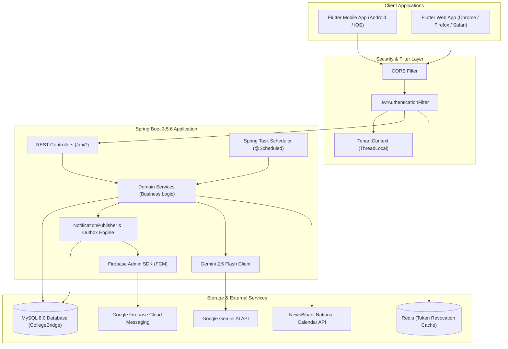
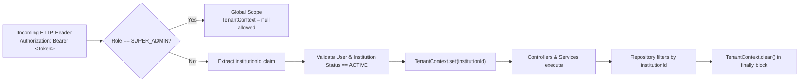
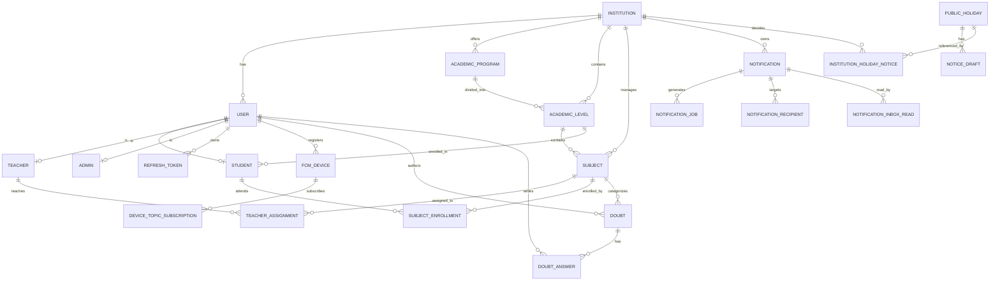
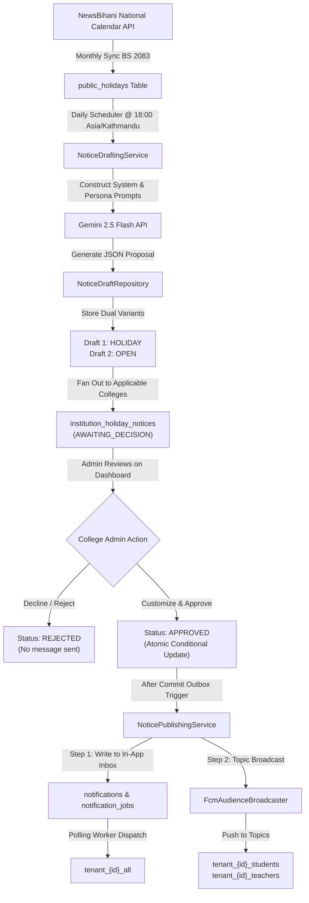

# College Bridge

> **A Multi-Tenant Smart Campus Communication, Academic Management, and AI-Powered Notification Platform**

[](https://openjdk.org/)
[](https://spring.io/projects/spring-boot)
[](https://flutter.dev/)
[](https://www.mysql.com/)
[](https://redis.io/)
[](https://firebase.google.com/)
[](https://ai.google.dev/)
[](#license)

---

## Table of Contents

- [Project Overview](#project-overview)
  - [The Problem](#the-problem)
  - [The Solution](#the-solution)
  - [Multi-Tenancy Model](#multi-tenancy-model)
- [Key Features](#key-features)
  - [Implemented Features](#implemented-features)
  - [Implementation Status & Boundaries](#implementation-status--boundaries)
- [System Architecture](#system-architecture)
  - [High-Level Architecture](#high-level-architecture)
  - [Request Lifecycle & Data Flow](#request-lifecycle--data-flow)
  - [Multi-Tenancy Request Flow](#multi-tenancy-request-flow)
- [Technology Stack](#technology-stack)
- [Project Directory Structure](#project-directory-structure)
  - [Monorepo Overview](#monorepo-overview)
  - [Backend Directory (`bridge`)](#backend-directory-bridge)
  - [Frontend Directory (`bridge_mobile`)](#frontend-directory-bridge_mobile)
- [Database Design](#database-design)
  - [Core Entity Relationships (ER Diagram)](#core-entity-relationships-er-diagram)
  - [Entity Dictionary](#entity-dictionary)
  - [Schema Migrations](#schema-migrations)
- [Authentication and Security](#authentication-and-security)
  - [RSA Asymmetric JWT Architecture](#rsa-asymmetric-jwt-architecture)
  - [Token Lifecycle & Revocation with Redis](#token-lifecycle--revocation-with-redis)
  - [Security Filter Chain & Role-Based Access Control](#security-filter-chain--role-based-access-control)
- [AI-Powered Holiday Announcement System](#ai-powered-holiday-announcement-system)
  - [Operational Workflow](#operational-workflow)
  - [Workflow Diagram](#workflow-diagram)
  - [Nepali Calendar Synchronization & Scoping](#nepali-calendar-synchronization--scoping)
  - [Dual Draft Generation via Gemini AI](#dual-draft-generation-via-gemini-ai)
  - [Admin Approval, Outbox Pattern & Publishing](#admin-approval-outbox-pattern--publishing)
- [Notification Architecture](#notification-architecture)
  - [Dual-Layer Notification Strategy](#dual-layer-notification-strategy)
  - [Topic Architecture](#topic-architecture)
  - [FCM Web & Mobile Push Engine](#fcm-web--mobile-push-engine)
- [API Documentation](#api-documentation)
  - [Authentication & Account Endpoints](#authentication--account-endpoints)
  - [Institution Onboarding & Administration](#institution-onboarding--administration)
  - [Academic Structure Management](#academic-structure-management)
  - [User & Role Management](#user--role-management)
  - [Doubt Forum Endpoints](#doubt-forum-endpoints)
  - [Notifications & Device Tokens](#notifications--device-tokens)
  - [Holiday Notices & AI Approval](#holiday-notices--ai-approval)
  - [Support Tickets & Dashboard Analytics](#support-tickets--dashboard-analytics)
- [Installation and Setup](#installation-and-setup)
  - [Prerequisites](#prerequisites)
  - [1. Clone Repository](#1-clone-repository)
  - [2. Database Configuration](#2-database-configuration)
  - [3. Redis Configuration](#3-redis-configuration)
  - [4. RSA Cryptographic Keys Generation](#4-rsa-cryptographic-keys-generation)
  - [5. Firebase Admin SDK & Web Push Setup](#5-firebase-admin-sdk--web-push-setup)
  - [6. Gemini AI API Key](#6-gemini-ai-api-key)
  - [7. Backend Execution](#7-backend-execution)
  - [8. Frontend Execution (Flutter)](#8-frontend-execution-flutter)
- [Environment Variables](#environment-variables)
- [Screenshots and Demo](#screenshots-and-demo)
- [Future Improvements](#future-improvements)
- [Contributing](#contributing)
- [License](#license)
- [Authors & Contact](#authors--contact)

---

## Project Overview

**College Bridge** is an enterprise-grade campus communication, academic orchestration, and notification platform tailored for colleges, universities, and educational networks.

### The Problem
Traditional colleges and higher education institutes struggle with severe communication friction:
1. **Fragmented Messaging Channels:** Important circulars rely on physical notice boards, scattered WhatsApp/Viber groups, and word of mouth, leading to missed notices and miscommunication.
2. **Delayed Class Announcements:** When a lecturer is delayed or an emergency cancellation occurs, students frequently travel long distances only to find an empty classroom.
3. **Manual Holiday Publishing Overload:** College administrators manually track official government holidays (Bikram Sambat / Gregorian calendars), determine regional applicability (Hills vs. Terai), manually draft circulars, and post them across disparate channels.
4. **Unstructured Academic Doubt Resolution:** Students lack a central, searchable, verified forum to ask academic questions directly to subject teachers or classmates.
5. **No Single Source of Truth:** Multi-campus institutions lack centralized tenant isolation, meaning administrators cannot supervise cohorts and communication without running separate instances.

### The Solution
College Bridge delivers an integrated mobile and web solution:
- **Instant Targeted Broadcasts:** Role-based push notifications dispatched directly to target students, specific classes/subjects, or the entire campus within milliseconds.
- **AI-Powered Automated Holiday Pipeline:** Daily synchronization with official national calendar feeds, Gemini 2.5 Flash generating professional bilingual/English announcements in dual variants (Formal Holiday vs. College Remains Open), and an admin one-click review dashboard.
- **Curated Academic Doubt Forum:** A community Q&A space where students post subject-tagged doubts and teachers formally verify answers.
- **Fail-Safe Multi-Tier Delivery:** Notifications are committed transactionally to a persistent in-app inbox and asynchronously dispatched via Firebase Cloud Messaging (FCM) topic hierarchies and background retry workers.

### Multi-Tenancy Model
College Bridge employs a **Logical Multi-Tenancy (Shared Database, Discriminator Column)** architecture:
- Every academic cohort, notice, user, class, subject, and device registration is tied to an `institution_id`.
- The backend enforces request-scoped tenant isolation through a `ThreadLocal` context (`TenantContext`) extracted directly from authenticated cryptographic JWT tokens.
- `SUPER_ADMIN` operators supervise platform-wide institutions and approvals globally, while `ADMIN`, `TEACHER`, and `STUDENT` users are strictly scoped to their assigned institution.

---

## Key Features

### Implemented Features

| Domain | Implemented Capabilities |
| :--- | :--- |
| **Multi-Tenancy** | Multi-institution registration with document uploads, verification lifecycle (`PENDING` -> `ACTIVE` / `REJECTED`), regional classification (Hills, Terai, Nationwide), and tenant isolation. |
| **Authentication & RBAC** | Asymmetric RSA-signed JWT access tokens, DB-backed rotating refresh tokens, Redis-backed instant token revocation on logout/password reset, and BCrypt password encryption. Four roles: `SUPER_ADMIN`, `ADMIN`, `TEACHER`, `STUDENT`. |
| **OTP & Password Recovery** | Email-based OTP delivery with time-limited verification windows (`otp.expiration.minutes=5`) for user activation and self-service password reset. |
| **Academic Hierarchy** | Structured institutional hierarchies: Academic Programs (e.g., BSc CSIT, BCA) -> Academic Levels/Semesters -> Subjects -> Student Cohort enrollments and Teacher Subject assignments with soft-delete support. |
| **Academic Doubt Forum** | Subject-scoped doubt posting, multi-student discussions, direct teacher answers, and official teacher answer verification (`VERIFIED` status). |
| **AI Holiday Announcements** | Automated NewsBihani calendar ingestion (BS 2083 / AD translation), Gemini 2.5 Flash dual-variant draft generation (`HOLIDAY` vs. `OPEN`), college admin review/customization, and scheduled automated publication. |
| **Hybrid Notifications** | Transactional outbox with MySQL database storage (`notifications` and `notification_jobs` tables) + FCM Push Notifications with role-scoped topics (`tenant_{id}_all`, `tenant_{id}_students`, `tenant_{id}_teachers`, `tenant_{id}_class_{id}`, `tenant_{id}_subject_{id}`). |
| **Background Processing** | Spring `@Scheduled` background engine with distributed lease locking (`SKIP LOCKED`) polling retryable jobs with exponential backoff. |
| **Cross-Platform Client** | Flutter mobile (Android/iOS) and Web application using Riverpod 2.x reactive state management, GoRouter, declarative routing, and service worker background push handling. |

### Implementation Status & Boundaries
To maintain technical integrity, the following features are actively implemented vs. intentionally stubbed or planned:
- ✅ **Fully Implemented:** JWT + Refresh + Redis Revocation, Academic Structure, Doubt Discussion & Teacher Verification, NewsBihani Calendar Sync, Gemini AI Draft Generation, Institution Notice Review & Publishing Outbox, In-App Notification Inbox with read tracking, FCM Topic Dispatcher, Flutter Android/Web App.
- 🟡 **Partially Implemented / Integrated as Stubs:**
  - `RabbitMQ (spring-boot-starter-amqp)` and `GraphQL (spring-boot-starter-graphql)` are present in `pom.xml` dependencies, but core domain messaging currently runs on the Spring internal event bus and the MySQL-backed transactional outbox worker.
  - `Cloudinary` configuration exists in `application.properties`, but active document and file storage routes currently default to local file storage (`uploads/`).

---

## System Architecture

### High-Level Architecture



### Request Lifecycle & Data Flow

Every authenticated API request passes through a strictly managed pipeline:

```mermaid
sequenceDiagram
    autonumber
    actor User as Client (Flutter Web/Mobile)
    participant Filter as JwtAuthenticationFilter
    participant Redis as Redis (Token Revocation)
    participant Ctx as TenantContext (ThreadLocal)
    participant Ctrl as Spring REST Controller
    participant Svc as Domain Service
    participant Repo as Spring Data JPA Repository
    participant DB as MySQL Database

    User->>Filter: HTTP Request + Bearer <JWT>
    Filter->>Filter: Parse claims (userId, institutionId, exp, issuedAt)
    Filter->>Redis: isTokenRevoked(userId, issuedAt)
    Redis-->>Filter: Token valid (Not revoked)
    Filter->>Ctx: set(institutionId)
    Filter->>Ctrl: Dispatch to matched handler
    Ctrl->>Svc: Execute business logic with DTO
    Svc->>Ctx: requireTenant() / get()
    Ctx-->>Svc: Tenant ID
    Svc->>Repo: Execute tenant-scoped query / mutation
    Repo->>DB: SQL query (WHERE institution_id = ?)
    DB-->>Repo: Result Set
    Repo-->>Svc: Entity / Domain Model
    Svc-->>Ctrl: Response DTO
    Ctrl-->>User: ApiResponse<T> (HTTP 200/201)
    Note over Filter,Ctx: finally { TenantContext.clear(); }
```

### Multi-Tenancy Request Flow



---

## Technology Stack

### Backend
- **Language & Runtime:** Java 21 (OpenJDK 21 Hotspot)
- **Framework:** Spring Boot 3.5.6
- **Web Layer:** Spring MVC (Web starter), SpringDoc OpenAPI Swagger 2.8.9
- **Data Persistence:** Spring Data JPA, Hibernate 6.6, HikariCP
- **Bean Mapping & Boilerplate:** MapStruct 1.5.5.Final, Project Lombok 1.18.40
- **Validation:** Jakarta Bean Validation (Hibernate Validator)
- **Retry Mechanism:** Spring Retry

### Frontend (Mobile & Web)
- **Framework:** Flutter 3.x (Dart 3.10+)
- **State Management:** Riverpod 2.6.1 (`flutter_riverpod`)
- **Navigation:** GoRouter 13.2.5
- **Networking:** Dio 5.11 with custom JWT Auth Interceptors
- **Secure Storage:** `flutter_secure_storage` 9.2.4
- **Local Notifications:** `flutter_local_notifications` 17.2.4
- **Web Push Integration:** Native Service Worker (`firebase-messaging-sw.js`), `universal_html`

### Database, Cache & Infrastructure
- **Relational Database:** MySQL 8.0 (Engine: InnoDB, Character Set: utf8mb4)
- **Caching & Revocation Store:** Redis 6.x / 7.x (via `spring-boot-starter-data-redis` and `StringRedisTemplate`)
- **Database Driver:** MySQL Connector/J

### Security & Cryptography
- **Security Engine:** Spring Security 6.5
- **Token Format:** Asymmetric RSA-2048 Signed JSON Web Tokens (JJWT 0.12.6)
- **Password Hashing:** BCrypt (Strength 10)
- **Asymmetric Encryption:** PKCS#8 RSA Private Key / X.509 RSA Public Key

### Notifications & AI
- **Push Notification Engine:** Google Firebase Cloud Messaging (Firebase Admin SDK 9.3.0)
- **AI Large Language Model:** Google Gemini 2.5 Flash (`generativelanguage.googleapis.com`)
- **Calendar API:** NewsBihani National Bikram Sambat Calendar Service

---

## Project Directory Structure

### Monorepo Overview
```text
College_bridge/
├── bridge/                # Backend Spring Boot 3.5.6 Application
└── bridge_mobile/         # Flutter Mobile (iOS, Android) and Web Application
```

### Backend Directory (`bridge`)
```text
bridge/
├── pom.xml                               # Maven project descriptor & dependencies
├── mvnw / mvnw.cmd                       # Maven wrapper binaries
├── src/
│   ├── main/
│   │   ├── java/com/college/bridge/
│   │   │   ├── BridgeApplication.java    # Application entry point & @EnableScheduling
│   │   │   ├── academic/                 # Academic hierarchies (Programs, Levels, Subjects)
│   │   │   │   ├── controller/           # Class, Subject, Enrollment, and Cohort endpoints
│   │   │   │   ├── entity/               # AcademicLevel, AcademicProgram, Subject, etc.
│   │   │   │   ├── repository/           # JPA Repositories with tenant scoping
│   │   │   │   └── service/              # Academic structure business logic
│   │   │   ├── auth/                     # Authentication, RBAC, Users, and Security
│   │   │   │   ├── controller/           # Auth, OTP, Profile, Admin User endpoints
│   │   │   │   ├── entity/               # User, Admin, Student, Teacher, RefreshToken, OTP
│   │   │   │   ├── repository/           # User and credential repositories
│   │   │   │   ├── security/             # SecurityConfig, JwtFilter, JwtService, RSA Key loader
│   │   │   │   └── service/              # Token revocation, user lifecycle, authentication
│   │   │   ├── common/                   # Cross-cutting concerns and shared infrastructure
│   │   │   │   ├── exception/            # Global exception handlers & custom domain exceptions
│   │   │   │   ├── response/             # Standardized ApiResponse<T> wrapper
│   │   │   │   └── tenant/               # ThreadLocal TenantContext container
│   │   │   ├── dashboard/                # Analytics & aggregation for Admins and Super Admins
│   │   │   ├── doubt/                    # Academic Q&A forum and teacher verification
│   │   │   │   ├── controller/           # Doubt and DoubtAnswer endpoints
│   │   │   │   ├── entity/               # Doubt, DoubtAnswer, DoubtStatus
│   │   │   │   └── service/              # Discussion and answer verification workflows
│   │   │   ├── holiday/                  # AI Holiday Announcement Engine
│   │   │   │   ├── application/          # Notice authoring, drafting, publishing, approval
│   │   │   │   ├── config/               # NepalClock (Asia/Kathmandu), HolidayProperties
│   │   │   │   ├── controller/           # Review, Approval, Rejection, Public Notice endpoints
│   │   │   │   ├── domain/               # PublicHoliday, InstitutionNotice, NoticeDraft
│   │   │   │   ├── infrastructure/       # Gemini AI client, NewsBihani calendar adapter, FCM broadcaster
│   │   │   │   └── scheduling/           # Cron triggers (Sync, Draft, Remind, Publish)
│   │   │   ├── institution/              # Multi-tenant onboarding and management
│   │   │   │   ├── controller/           # Registration, SuperAdmin approval, Profile
│   │   │   │   ├── entity/               # Institution, InstitutionDocument, InstitutionStatus
│   │   │   │   └── service/              # Document verification and tenant lifecycle
│   │   │   ├── notification/             # Notification engine & transactional outbox
│   │   │   │   ├── controller/           # Notification dispatch, inbox, and device token routes
│   │   │   │   ├── entity/               # Notification, NotificationJob, FcmDevice, Subscriptions
│   │   │   │   ├── fcm/                  # FirebaseConfig, FcmNotificationService, TopicResolver
│   │   │   │   ├── repository/           # Notification outbox & recipient repositories
│   │   │   │   ├── service/              # NotificationPublisher, JobProcessor, TopicSync
│   │   │   │   └── worker/               # Background lease worker polling due notification jobs
│   │   │   └── support/                  # Helpdesk and user support ticketing
│   │   └── resources/
│   │       ├── application.properties    # Central configuration file
│   │       ├── db/migration/             # Versioned schema migrations
│   │       └── keys/                     # RSA private/public PEM keys & Firebase service JSON
│   └── test/                             # Automated JUnit 5 & Mockito test suite
```

### Frontend Directory (`bridge_mobile`)
```text
bridge_mobile/
├── pubspec.yaml                          # Flutter package dependencies and assets
├── web/
│   ├── index.html                        # Web entrypoint with service worker registration
│   └── firebase-messaging-sw.js          # Service worker for background web push notifications
├── lib/
│   ├── main.dart                         # Flutter entry point, Firebase init, Riverpod scope
│   ├── firebase_options.dart             # Generated Firebase platform configurations
│   ├── app/
│   │   ├── constants/                    # Application UI constants
│   │   └── theme/                        # App colors, Typography, Material 3 theme data
│   ├── core/
│   │   ├── constants/                    # ApiEndpoints configuration
│   │   ├── error/                        # Failures and UI error mapper
│   │   ├── network/                      # Dio ApiClient with auth bearer and refresh interceptors
│   │   ├── router/                       # GoRouter route declarations and redirect guards
│   │   ├── services/                     # FcmService (push token lifecycle, web/mobile routing)
│   │   └── storage/                      # FlutterSecureStorage service
│   └── features/
│       ├── academics/                    # Class and subject management UI & state
│       ├── auth/                         # Login, registration, OTP, and password reset screens
│       ├── dashboard/                    # Role-specific dashboards (Admin, Teacher, Student, SuperAdmin)
│       ├── doubts/                       # Q&A discussion feed, answer creator, verified badge UI
│       ├── holiday_notices/              # Admin review/approval screen & Official notices feed
│       ├── institution_admin/            # College admin administration screens
│       ├── institution_registration/     # Public college onboarding flow
│       ├── notifications/                # In-app notification bell, inbox, and broadcast composer
│       └── profile/                      # User profile viewing and credential updates
└── test/                                 # Widget, Unit, and Integration test suite
```

---

## Database Design

### Core Entity Relationships (ER Diagram)



### Entity Dictionary

| Table Name | Entity Class | Responsibility |
| :--- | :--- | :--- |
| `institutions` | `Institution` | The root tenant. Stores college metadata, verification status, contact info, and regional scope (`HILLS`, `TERAI`, `NATIONWIDE`). |
| `users` | `User` | Core principal entity containing credentials, role (`SUPER_ADMIN`, `ADMIN`, `TEACHER`, `STUDENT`), activation state, and foreign key to `Institution`. |
| `admins`, `teachers`, `students` | `Admin`, `Teacher`, `Student` | Role-specific profile extensions. `Student` links to current `AcademicLevel`; `Teacher` links to assignments. |
| `refresh_tokens` | `RefreshToken` | Cryptographically random refresh tokens with explicit expiry dates and revocation flags for sliding sessions. |
| `academic_programs` | `AcademicProgram` | High-level degree or faculty track (e.g., Computer Science, Management). |
| `academic_levels` | `AcademicLevel` | Specific cohorts, years, or semesters within a program (e.g., Semester 4, Year 1). |
| `subjects` | `Subject` | Distinct curriculum course belonging to an academic level and institution. |
| `teacher_assignments` | `TeacherAssignment` | Mapping table establishing which teacher instructs which subject in a given semester. |
| `subject_enrollments` | `SubjectEnrollment` | Tracks active student enrollment in subjects with status flags (`ACTIVE`, `COMPLETED`, `DROPPED`). |
| `doubts` | `Doubt` | Student questions tagged with an academic subject, title, body, and status (`OPEN`, `RESOLVED`). |
| `doubt_answers` | `DoubtAnswer` | Responses submitted by peers or teachers, including verification metadata (`is_verified_by_teacher`). |
| `notifications` | `Notification` | Transactional inbox store containing sender attribution, audience target type, and message payloads. |
| `notification_jobs` | `NotificationJob` | Outbox worker queue rows tracking delivery status (`PENDING`, `PROCESSING`, `SENT`, `DEAD`) and retry attempts. |
| `fcm_devices` | `FcmDevice` | Device tokens registered by active users with platform markers (`ANDROID`, `IOS`, `WEB`). |
| `device_topic_subscriptions` | `DeviceTopicSubscription`| Local ledger of active Firebase topic subscriptions per device. |
| `public_holidays` | `PublicHoliday` | Ingested national holiday calendar records with Gregorian and Bikram Sambat dates and regional applicability. |
| `notice_drafts` | `NoticeDraft` | Platform-wide AI-generated announcement proposals (`HOLIDAY` variant vs. `OPEN` variant). |
| `institution_holiday_notices` | `InstitutionNotice` | Per-institution announcement decisions (`AWAITING_DECISION`, `APPROVED`, `REJECTED`, `PUBLISHED`, `FAILED`). |

### Schema Migrations
The database schema evolution is structured under `src/main/resources/db/migration/`:
- `V2__normalize_academic_hierarchy.sql`: Normalizes programs, levels, and subject relationships.
- `V3__add_soft_delete_academic_structure.sql`: Introduces `deleted` and audit timestamps across academic tables.
- `V4__add_fcm_and_update_notifications.sql`: Establishes device registration tables, topic subscriptions, and notification jobs.
- `V5__add_notification_inbox_reads.sql`: Adds per-user read receipt tracking (`notification_inbox_reads`).

---

## Authentication and Security

### RSA Asymmetric JWT Architecture
College Bridge utilizes asymmetric cryptography (RSA-2048) for JWT operations:
- **Private Key (`classpath:keys/private_key.pem`):** Kept strictly on the backend to digitally sign authentication tokens using the RS256 algorithm.
- **Public Key (`classpath:keys/public_key.pem`):** Used to verify the integrity and signature of incoming requests.

```text
Access Token Payload Claims:
{
  "sub": "radhikaxtha101@gmail.com",
  "userId": 20,
  "institutionId": 15,
  "role": "ROLE_ADMIN",
  "iat": 1731732000,
  "exp": 1731732900
}
```

### Token Lifecycle & Revocation with Redis
- **Access Tokens:** Short-lived (default: **15 minutes** / `900000ms`), stateless.
- **Refresh Tokens:** Long-lived (default: **7 days** / `604800000ms`), stored in the `refresh_tokens` database table with revocation flags.
- **Instant Revocation via Redis:**
  To maintain stateless authentication while allowing immediate logout or password-reset invalidation, the backend utilizes `UserTokenRevocationService`:
  1. When a user logs out or changes their password, a key is written to Redis:  
     `user:revoked-at:<userId> = <epochTimestamp>` with a TTL equal to the access token lifespan.
  2. In `JwtAuthenticationFilter`, every request's token `issuedAt` timestamp is verified against Redis. If `issuedAt <= revokedAt`, the request is rejected immediately without hitting the database.

### Security Filter Chain & Role-Based Access Control
The application enforces strict method and URL-level security in `SecurityConfig.java`:
- **Public Endpoints:** `/api/auth/register`, `/api/auth/login`, `/api/auth/refresh`, `/api/auth/password/**`, `/api/otp/**`, `/api/public/**`.
- **Super Administrator (`ROLE_SUPER_ADMIN`):** `/api/super-admin/**` (institution approvals, global platform oversight).
- **Institution Administrator (`ROLE_ADMIN`):** `/api/admin/**`, `/api/files/**`, teacher/student registration, cohort creation, holiday decision approval.
- **Teacher (`ROLE_TEACHER`):** Doubt answer creation, answer verification (`PATCH /api/doubts/*/answers/*/verify`), class broadcasts.
- **Student (`ROLE_STUDENT`):** Doubt question submission (`POST /api/doubts`), answer submissions.

---

## AI-Powered Holiday Announcement System

### Operational Workflow
The holiday announcement module is designed to eliminate manual administration while ensuring **zero unverified announcements** are ever dispatched without administrative consent.



### Nepali Calendar Synchronization & Scoping
1. **Automated Calendar Ingestion:** `HolidayCalendarSyncService` periodically queries the national holiday feed for Bikram Sambat years (e.g., BS 2083) and records Gregorian dates, BS dates, and scopes.
2. **Geographical Scoping:** Evaluates regional applicability:
   - `NATIONWIDE`: Applied to all colleges.
   - `HILLS`: Applied only to institutions located in hill districts (e.g., Kathmandu, Pokhara).
   - `TERAI`: Applied only to colleges located in Terai plains.

### Dual Draft Generation via Gemini AI
For every upcoming holiday, `GeminiNoticeWriter` communicates with Google Gemini 2.5 Flash over a secure HTTPS channel (`x-goog-api-key`). It requests two distinct announcement drafts:
- **Variant A (`HOLIDAY`):** A warm, professional notice announcing the college will remain closed in celebration of the holiday.
- **Variant B (`OPEN`):** A formal notice clarifying that classes and administrative operations will continue normally despite the public observance.

### Admin Approval, Outbox Pattern & Publishing
- **Zero Hallucination Guarantee:** AI drafts are strictly proposals. The administrator can accept the AI draft as-is, edit the title, or write a custom message.
- **Atomic Concurrency Control:** Notice transitions occur via conditional atomic SQL:
  ```sql
  UPDATE institution_holiday_notices n
     SET n.status = 'APPROVED', n.final_title = :title, ...
   WHERE n.holiday_id = :holidayId AND n.institution_id = :institutionId
     AND n.status = 'AWAITING_DECISION'
  ```
  This guarantees two college administrators can never approve or conflict on the same decision.
- **Publishing Step:** Once approved, `NoticePublishingService` transactionally logs the notification into the user inbox first, then asynchronously pushes to FCM audience topics.

---

## Notification Architecture

### Dual-Layer Notification Strategy
College Bridge avoids push notification fragility by employing a dual-layer strategy:
1. **Persistent In-App Inbox (`notifications` table):**
   Every announcement and notification is saved to the relational database. When a student or teacher opens their application, the notification bell queries `GET /api/notifications/inbox`. The notification is always visible, even if the user had their phone turned off or disabled notifications.
2. **Push Delivery Layer (Firebase Cloud Messaging):**
   Dispatches heads-up popups and lock-screen banners to active devices.

### Topic Architecture
The backend uses structured topic channels for instant multicast routing without storing millions of individual device push jobs:

| Topic Pattern | Target Audience |
| :--- | :--- |
| `tenant_{institutionId}_all` | Entire college community (Admins, Teachers, Students). |
| `tenant_{institutionId}_students` | All enrolled students within that specific college. |
| `tenant_{institutionId}_teachers` | All verified teachers within that specific college. |
| `tenant_{institutionId}_admins` | College administrators. |
| `tenant_{institutionId}_class_{levelId}` | Students enrolled in a specific class / semester. |
| `tenant_{institutionId}_subject_{subjectId}` | Students and teachers associated with a specific subject. |

### FCM Web & Mobile Push Engine
- **Mobile (Android/iOS):** Tokens are registered upon login via `POST /api/devices/fcm-token`. Background notifications display via native system notification trays.
- **Web (Chrome/Firefox/Edge):** The client registers `web/firebase-messaging-sw.js` with Web Push VAPID credentials. When the tab is active, in-app notifications are rendered; when backgrounded or closed, the service worker displays native OS desktop banners.

---

## API Documentation

All secured endpoints require the `Authorization: Bearer <JWT_ACCESS_TOKEN>` header. Responses conform to the standard `ApiResponse<T>` envelope:
```json
{
  "success": true,
  "message": "Operation completed successfully",
  "data": { ... },
  "timestamp": "2026-11-16T08:00:00Z"
}
```

### Authentication & Account Endpoints

#### Register Institution Admin
- **POST** `/api/auth/register`
- **Auth:** None (Public)
- **Request Body:**
  ```json
  {
    "name": "Jane Doe",
    "email": "jane@college.edu",
    "password": "SecurePassword123!",
    "phone": "9800000000",
    "institutionId": 15
  }
  ```

#### User Login
- **POST** `/api/auth/login`
- **Auth:** None (Public)
- **Request Body:**
  ```json
  {
    "email": "jane@college.edu",
    "password": "SecurePassword123!"
  }
  ```
- **Response Body:**
  ```json
  {
    "success": true,
    "data": {
      "accessToken": "eyJhbGciOiJSUzI1NiIs...",
      "refreshToken": "48b6c8d2-...",
      "tokenType": "Bearer",
      "user": {
        "userId": 20,
        "email": "jane@college.edu",
        "role": "ADMIN",
        "institutionId": 15
      }
    }
  }
  ```

#### Refresh Access Token
- **POST** `/api/auth/refresh`
- **Auth:** None (Requires valid refresh token)
- **Request Body:**
  ```json
  {
    "refreshToken": "48b6c8d2-..."
  }
  ```

#### Logout & Token Revocation
- **POST** `/api/auth/logout`
- **Auth:** Authenticated
- **Purpose:** Flags refresh token as revoked in MySQL and adds access token timestamp to Redis revocation blocklist.

---

### Institution Onboarding & Administration

#### Register College (Public Onboarding)
- **POST** `/api/auth/register-institution`
- **Auth:** None (Public)
- **Content-Type:** `multipart/form-data`
- **Fields:** `name`, `code`, `email`, `phone`, `address`, `region` (`HILLS` / `TERAI` / `NATIONWIDE`), `documents` (PDF/Image file).

#### Approve Institution
- **PATCH** `/api/super-admin/institutions/{id}/approve`
- **Auth:** `SUPER_ADMIN`
- **Purpose:** Activates pending college registration, enabling users to log in.

---

### Academic Structure Management

#### Create Academic Program
- **POST** `/api/admin/academic/programs`
- **Auth:** `ADMIN`
- **Request Body:**
  ```json
  {
    "name": "Bachelor of Science in Computer Science & IT",
    "code": "BSc.CSIT",
    "totalSemesters": 8
  }
  ```

#### Create Academic Level (Semester/Cohort)
- **POST** `/api/admin/academic/levels`
- **Auth:** `ADMIN`
- **Request Body:**
  ```json
  {
    "name": "Semester 4",
    "levelNumber": 4,
    "programId": 1
  }
  ```

#### Create Subject
- **POST** `/api/admin/academic/subjects`
- **Auth:** `ADMIN`
- **Request Body:**
  ```json
  {
    "name": "Database Management Systems",
    "code": "CSC260",
    "academicLevelId": 27
  }
  ```

#### Assign Teacher to Subject
- **POST** `/api/admin/academic/teachers/assignments`
- **Auth:** `ADMIN`
- **Request Body:**
  ```json
  {
    "teacherId": 5,
    "subjectId": 12
  }
  ```

---

### User & Role Management

#### Register Student
- **POST** `/api/admin/students`
- **Auth:** `ADMIN`
- **Request Body:**
  ```json
  {
    "name": "John Doe",
    "email": "john.student@college.edu",
    "phone": "9812345678",
    "academicLevelId": 27,
    "rollNumber": "CSIT-2080-01"
  }
  ```

#### Register Teacher
- **POST** `/api/admin/teachers`
- **Auth:** `ADMIN`
- **Request Body:**
  ```json
  {
    "name": "Prof. Alan Turing",
    "email": "alan@college.edu",
    "phone": "9841000000",
    "designation": "Associate Professor"
  }
  ```

---

### Doubt Forum Endpoints

#### Post Academic Doubt
- **POST** `/api/doubts`
- **Auth:** `STUDENT`
- **Request Body:**
  ```json
  {
    "subjectId": 12,
    "title": "Difference between B-Tree and B+ Tree indexing?",
    "description": "Can someone explain why leaf node linking matters in B+ trees?"
  }
  ```

#### Answer a Doubt
- **POST** `/api/doubts/{doubtId}/answers`
- **Auth:** `STUDENT`, `TEACHER`
- **Request Body:**
  ```json
  {
    "content": "B+ Trees store all actual record keys in leaf nodes and link them as a linked list, making range scans O(k)..."
  }
  ```

#### Verify Answer (Teacher Only)
- **PATCH** `/api/doubts/{doubtId}/answers/{answerId}/verify`
- **Auth:** `TEACHER`
- **Purpose:** Marks the answer with an official teacher verification checkmark.

---

### Notifications & Device Tokens

#### Register FCM Device Token
- **POST** `/api/devices/fcm-token`
- **Auth:** Authenticated
- **Request Body:**
  ```json
  {
    "token": "c4cnt9BbNIqOG4NlgNUM91:APA91bF...",
    "platform": "WEB"
  }
  ```

#### Dispatch Broadcast Notification
- **POST** `/api/notifications`
- **Auth:** `ADMIN`, `TEACHER`
- **Request Body:**
  ```json
  {
    "title": "Lab Examination Schedule Revised",
    "body": "The Operating Systems lab test has been moved to Thursday 10:00 AM.",
    "targetType": "CLASS",
    "targetId": 27
  }
  ```

#### Retrieve Personal Notification Inbox
- **GET** `/api/notifications/inbox?page=0&size=20`
- **Auth:** Authenticated
- **Purpose:** Returns paginated inbox items targeted to the user's institution, class, subject, or direct user ID.

---

### Holiday Notices & AI Approval

#### List Pending Holiday Announcements
- **GET** `/api/admin/holiday-notices/pending`
- **Auth:** `ADMIN`
- **Purpose:** Returns upcoming holidays awaiting college approval along with the dual AI-generated proposals.

#### Approve and Broadcast Holiday Notice
- **POST** `/api/admin/holiday-notices/approve`
- **Auth:** `ADMIN`
- **Request Body:**
  ```json
  {
    "holidayId": 37,
    "variant": "HOLIDAY",
    "customTitle": "Holiday Notice: Buddha Jayanti Observance",
    "customBody": "Dear students and staff, the college will remain closed on Wednesday in observance of Buddha Jayanti.",
    "audience": ["STUDENTS", "TEACHERS"]
  }
  ```

#### Reject Holiday Announcement
- **POST** `/api/admin/holiday-notices/{holidayId}/reject`
- **Auth:** `ADMIN`
- **Purpose:** Discards announcement generation for this holiday. No notification is delivered.

#### Retrieve Official Published Notices Feed
- **GET** `/api/holiday-notices/official?page=0&size=10`
- **Auth:** Authenticated (Students, Teachers, Admins)
- **Purpose:** Publicly displays official holiday decisions decided by the institution.

---

### Support Tickets & Dashboard Analytics

#### Create Support Ticket
- **POST** `/api/support/tickets`
- **Auth:** Authenticated
- **Request Body:**
  ```json
  {
    "subject": "Unable to access Semester 4 Database subject",
    "description": "My enrollment list does not show CSC260."
  }
  ```

#### Get Admin Dashboard Statistics
- **GET** `/api/admin/dashboard/stats`
- **Auth:** `ADMIN`
- **Response:** Total active students, teachers, subjects, open doubts, and pending notices.

---

## Installation and Setup

### Prerequisites
- **Java Development Kit (JDK):** Version 21 or later.
- **Node / Build Tools:** Standard build environment.
- **Database Server:** MySQL 8.0+
- **In-Memory Cache:** Redis 6.x or 7.x
- **Flutter SDK:** Version 3.10+ (Channel stable)
- **Google Cloud / Firebase Project:** Project with Firebase Cloud Messaging enabled.

---

### 1. Clone Repository
```bash
git clone https://github.com/shroyash/college-bridge.git
cd college-bridge
```

---

### 2. Database Configuration
Log in to MySQL and initialize the database:
```sql
CREATE DATABASE CollegeBridge CHARACTER SET utf8mb4 COLLATE utf8mb4_unicode_ci;
```

---

### 3. Redis Configuration
Ensure Redis is running locally on port `6379`:
```bash
redis-server --daemonize yes
redis-cli ping
# Expected output: PONG
```

---

### 4. RSA Cryptographic Keys Generation
College Bridge signs JWTs using RSA-2048 keys. Generate valid PEM files if not already present:
```bash
mkdir -p bridge/src/main/resources/keys
cd bridge/src/main/resources/keys

# Generate private RSA key (PKCS#8)
openssl genpkey -algorithm RSA -out private_key.pem -pkeyopt rsa_keygen_bits:2048

# Extract public RSA key (X.509)
openssl rsa -pubout -in private_key.pem -out public_key.pem
```

---

### 5. Firebase Admin SDK & Web Push Setup
1. In the [Firebase Console](https://console.firebase.google.com/), open **Project Settings** -> **Service accounts**.
2. Click **Generate new private key** and save the JSON file to:
   `bridge/src/main/resources/keys/firebase-service-account.json`
3. Update `firebase.config.path` in `application.properties` or provide via `FIREBASE_CONFIG_PATH`.
4. In **Project Settings** -> **Cloud Messaging**, generate a **Web Push certificate (VAPID key)**.
5. Paste your public VAPID key into `bridge_mobile/lib/core/services/fcm_service.dart`:
   ```dart
   static const String _vapidKey = 'YOUR_GENERATED_VAPID_KEY';
   ```

---

### 6. Gemini AI API Key
Obtain a free API Key from [Google AI Studio](https://aistudio.google.com/) and configure the environment variable:
```bash
export GEMINI_API_KEY="AIzaSy..."
```

---

### 7. Backend Execution
From the `bridge/` directory:
```bash
cd bridge

# Export runtime environment variables
export DB_HOST="localhost"
export DB_PORT="3306"
export DB_NAME="CollegeBridge"
export DB_USERNAME="your_mysql_username"
export DB_PASSWORD="your_mysql_password"
export REDIS_HOST="localhost"
export REDIS_PORT="6379"
export GEMINI_API_KEY="your_gemini_api_key"

# Compile and execute
./mvnw clean spring-boot:run
```
The server will bind to `http://localhost:8080`.  
Access interactive Swagger UI documentation at: `http://localhost:8080/swagger-ui.html`.

---

### 8. Frontend Execution (Flutter)
From the `bridge_mobile/` directory:
```bash
cd bridge_mobile

# Install Flutter dependencies
flutter pub get

# Run on Web (Chrome)
flutter run -d chrome

# Or run on Connected Mobile Device / Android Emulator
flutter run
```

---

## Environment Variables

| Variable | Description | Default Value | Required |
| :--- | :--- | :--- | :--- |
| `SERVER_PORT` | HTTP port for Spring Boot application | `8080` | No |
| `DB_HOST` | MySQL hostname or IP address | `localhost` | Yes |
| `DB_PORT` | MySQL connection port | `3306` | Yes |
| `DB_NAME` | Database schema name | `CollegeBridge` | Yes |
| `DB_USERNAME` | MySQL database username | `shroyash` | Yes |
| `DB_PASSWORD` | MySQL database password | *(empty)* | Yes |
| `REDIS_HOST` | Redis host for session revocation | `localhost` | Yes |
| `REDIS_PORT` | Redis TCP port | `6379` | Yes |
| `REDIS_PASSWORD` | Redis authentication password | *(empty)* | No |
| `GEMINI_API_KEY` | Google Gemini 2.5 Flash API Key | *(empty)* | Yes (for AI holiday drafts) |
| `FIREBASE_CONFIG_PATH` | Path to Firebase Service Account JSON | `keys/firebase-service-account.json` | Yes (for FCM push) |
| `MAIL_USERNAME` | SMTP email address for OTP delivery | *(empty)* | Optional (Email OTP) |
| `MAIL_PASSWORD` | SMTP application password | *(empty)* | Optional (Email OTP) |
| `CLOUDINARY_CLOUD_NAME`| Cloudinary storage cloud name | *(empty)* | Optional |
| `CLOUDINARY_API_KEY` | Cloudinary storage API Key | *(empty)* | Optional |
| `CLOUDINARY_API_SECRET`| Cloudinary storage API Secret | *(empty)* | Optional |

---

## Screenshots and Demo

<!-- Placeholders for system demo captures -->
| Screen | Preview Placeholder |
| :--- | :--- |
| **Authentication & Login** |  |
| **Admin Control Dashboard** |  |
| **AI Holiday Notice Approval** |  |
| **Teacher Subject Dashboard** |  |
| **Academic Doubt Discussion** |  |
| **Notification Center (Web & Mobile)** |  |

---

## Future Improvements

The following architectural and feature enhancements are planned for future iterations:
- **RabbitMQ Integration:** Migrate notification delivery worker from MySQL database polling (`SKIP LOCKED`) to RabbitMQ topic exchanges for high-throughput messaging.
- **GraphQL Gateway:** Implement GraphQL queries for personalized mobile dashboard data fetching to eliminate REST over-fetching.
- **Cloud Object Storage:** Transition file attachments and institution KYC verification documents from local filesystem (`uploads/`) to Amazon S3 or Google Cloud Storage.
- **Attendance & Grading Module:** Introduce attendance check-ins and test evaluation directly linked to academic subjects and levels.
- **Real-Time WebSockets:** Implement live peer-to-peer doubt typing indicators and instant chat.

---

## Contributing

Contributions to College Bridge are welcome! Follow these steps:

1. **Fork the Repository:** Create your own branch on GitHub.
2. **Create a Feature Branch:**
   ```bash
   git checkout -b feature/amazing-feature
   ```
3. **Commit Your Changes:**
   ```bash
   git commit -m "feat: add comprehensive audit logging"
   ```
4. **Run Unit & Integration Tests:**
   ```bash
   # Backend tests
   cd bridge && ./mvnw test
   # Frontend tests
   cd ../bridge_mobile && flutter test
   ```
5. **Push to Your Branch:**
   ```bash
   git push origin feature/amazing-feature
   ```
6. **Open a Pull Request:** Submit your PR against `main` with detailed release notes.

---

## License

This repository does not currently contain an explicit open-source license file. All rights are reserved by the original author. For licensing inquiries or commercial use, please contact the maintainer directly.

---

## Authors & Contact

- **Primary Maintainer & Architect:** Shroyash Shrestha
- **GitHub:** [@shroyash](https://github.com/shroyash)
- **Repository Backend:** [college-bridge](https://github.com/shroyash/college-bridge)
- **Repository Frontend:** [CollegeBridge-Frontend](https://github.com/shroyash/CollegeBridge-Frontend)
- **Email:** `shroyash35@gmail.com`
